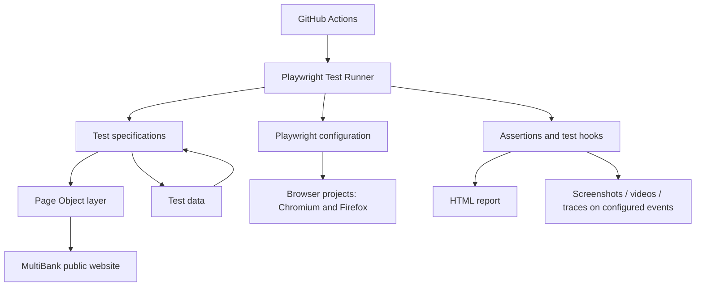

# MultiBank Web UI Automation

A Playwright + TypeScript automation project for validating key user-facing journeys on the MultiBank public website.

The framework focuses on the areas covered by the assignment: navigation, spot-market content, homepage/company content, negative scenarios, and a visual regression baseline. It uses Playwright Test, Page Object Model (POM), reusable test data, and a GitHub Actions workflow.

> **Target URL:** `https://mb.io/en`. This is the confirmed target for this assignment and the base URL used by the checked-in tests. The Spot market page is reached at `/en/explore`.

---

## What has been implemented

### Task 1 – Web UI automation

| Assignment area | Implemented coverage | Current status / notes |

|---|---|---|

| Navigation and layout | Checks expected navigation labels, validates their `href` patterns, checks Sign in / Sign up destinations, and checks desktop horizontal overflow and header visibility. | Implemented in `navigation.spec.ts`. Desktop layout is checked at `1366 × 768`; the suite also includes mobile-width validation and visual coverage at `1440 × 900`. |

| Spot trading | Checks that the Spot market heading and table render, verifies that rows are present, checks the Hot / Gainers / Losers controls, and validates the visible asset, price and percentage-change fields. | Implemented in `trading.spec.ts`. The inspected page presents individual crypto assets and market values; tests should not describe these as BTC/USD-style pairs unless the product actually displays pairs. |

| Content and links | Checks the homepage hero content, the Company page, key headings, selected images and section text. | Implemented in `content-links.spec.ts`. |

| App Store / Google Play links | **Skipped.** During inspection, neither an App Store link nor a Google Play link was found in the homepage DOM. | These checks were not executed because the required link elements were unavailable to target. This is not reported as a passing test, and it does not mean the store links themselves are broken. |

| Negative / edge cases | Checks invalid-route handling and a 375px mobile viewport for horizontal overflow. | Implemented in `edge-cases.spec.ts`. |

| Visual regression (bonus) | Captures a full-page homepage screenshot at 1440 × 900 and compares it with a committed baseline. | Implemented in `bonus.spec.ts`. The configured `maxDiffPixelRatio` is `0.02`; review visual diffs before updating the baseline. |

| API response validation (bonus) | No API contract test is currently included. | Not implemented. |

| Parameterized test data (bonus) | Navigation labels and expected URL patterns are data-driven; desktop viewport configuration is also stored separately. | Partial data-driven coverage; no BTC/USD or ETH/USD pair tests are claimed. |

| GitHub Actions (bonus) | A workflow is present to install dependencies, install Chromium, run Playwright tests and upload test artifacts. | See the CI notes below; there are currently two workflow files and one is stale. |

### Highlights

- TypeScript-based Playwright Test framework.

- Page Object Model classes for navigation, homepage content, company content and the spot-market section.

- Test data separated from test specifications.

- Assertions use Playwright's locator and web-first assertion APIs.

- Tests are grouped by business area.

- Screenshot-on-failure, video-on-failure and trace-on-first-retry are configured.

- A visual baseline is stored with the test.

- GitHub Actions workflow is included for automated execution.

---

## Framework architecture

The tests are kept separate from page interactions and test data. A spec describes *what* is being validated; page objects encapsulate *how* the page is located and interacted with; data files hold expected labels and values.



### Design choices

- **Page Object Model:** Repeated page-level locators and actions live in `tests/pages/`, keeping test intent readable and reducing selector duplication.

- **Data separation:** Navigation expectations, trading field definitions and content expectations live in `tests/data/`.

- **Playwright Test:** Provides browser fixtures, test isolation, web-first assertions, retries, traces and HTML reporting.

- **TypeScript:** Adds type checking and makes the test code easier to maintain as the suite grows.

- **Risk-aware scope:** Financial transactions are not submitted. The assignment's public pages can be tested without logging in or entering personal or financial information.

---

## Repository structure

```text

playwright-api-ui-automation-main/

├── .github/

│   ├── agents/

│   │   ├── playwright-test-generator.agent.md

│   │   ├── playwright-test-healer.agent.md

│   │   └── playwright-test-planner.agent.md

│   └── workflows/

│       ├── playwright.yml

│       └── playwright-tests.yml

│

├── .vscode/

│   ├── settings.json

│   └── mcp.json

│

├── tests/

│   ├── data/

│   │   └── multibank/

│   │       ├── content.ts

│   │       ├── navigation.ts

│   │       └── tradingPairs.ts

│   │

│   ├── pages/

│   │   └── multibank/

│   │       ├── HomePage.ts

│   │       ├── Navigation.ts

│   │       ├── SpotTradingSection.ts

│   │       ├── TradingPage.ts

│   │       └── WhyMultiBankPage.ts

│   │

│   ├── multibank/

│   │   ├── bonus.spec.ts

│   │   ├── content-links.spec.ts

│   │   ├── edge-cases.spec.ts

│   │   ├── navigation.spec.ts

│   │   ├── trading.spec.ts

│   │   └── bonus.spec.ts-snapshots/

│   │       └── homepage-chromium-darwin.png

│   │

│   └── seed.spec.ts

│

├── .gitignore                 

├── package.json

├── package-lock.json

├── playwright.config.ts

├── README.md

├── playwright-report/         # Generated HTML report; do not treat as source

└── test-results/              # Generated run output; do not treat as source

```

`node_modules/` is installed locally and is intentionally not shown in the source tree above. It should not be committed to Git.

### Main test files

| File | Responsibility |

|---|---|

| `tests/multibank/navigation.spec.ts` | Navigation visibility, destination patterns, header actions and desktop layout. |

| `tests/multibank/trading.spec.ts` | Spot-market section, market rows, category controls and market data field checks. |

| `tests/multibank/content-links.spec.ts` | Homepage hero, Company page headings/content/images, and explicit skips for unavailable app-store links. |

| `tests/multibank/edge-cases.spec.ts` | Invalid route and mobile horizontal-overflow checks. |

| `tests/multibank/bonus.spec.ts` | Homepage visual snapshot comparison. |

### Page objects

| Page object | Responsibility |

|---|---|

| `Navigation.ts` | Header navigation and link access. |

| `TradingPage.ts` | Spot-market navigation, categories, rows and market-data assertions. |

| `SpotTradingSection.ts` | Reusable locators for a spot-trading region, tabs and table. |

| `HomePage.ts` | Homepage hero section and hero copy. |

| `WhyMultiBankPage.ts` | Company page headings, imagery and key section text. |

### Test data

- `navigation.ts` – expected navigation labels, URL patterns, header actions and desktop viewport values.

- `tradingPairs.ts` – expected trading field labels and trading viewport configuration.

- `content.ts` – base URL, Company page URL, homepage hero heading and Company page content expectations.

---

## Prerequisites

- Node.js (use Node 20 LTS for local and CI consistency).

- npm.

- Git.

## Install

Clone the repository, then run:

```bash

npm ci

npx playwright install chromium firefox

```

On Linux CI or a fresh Linux machine, install browser system dependencies as well:

```bash

npx playwright install --with-deps chromium firefox

```

## Run the tests

Run the complete suite:

```bash

npm test

```

Run a specific area:

```bash

npx playwright test tests/multibank/navigation.spec.ts

npx playwright test tests/multibank/trading.spec.ts

npx playwright test tests/multibank/content-links.spec.ts

npx playwright test tests/multibank/edge-cases.spec.ts

npx playwright test tests/multibank/bonus.spec.ts

```

Run sequentially while debugging:

```bash

npx playwright test --workers=1

```

Run with a visible browser:

```bash

npx playwright test --headed --workers=1

```

Open the HTML report after a test run:

```bash

npx playwright show-report

```

The configured `npm test` command is the single-command entry point for the full suite.

---

## Visual regression

The visual test is in `tests/multibank/bonus.spec.ts`. It captures the homepage at `1440 × 900`, takes a full-page screenshot and compares it against the baseline stored under:

```text

tests/multibank/bonus.spec.ts-snapshots/homepage-chromium-darwin.png

```

Run the visual test normally to compare against the existing baseline:

```bash

npx playwright test tests/multibank/bonus.spec.ts

```

Only update the baseline after reviewing the actual, expected and diff images:

```bash

npx playwright test tests/multibank/bonus.spec.ts --update-snapshots

```

The test currently allows a maximum pixel-difference ratio of `0.02` (2%). This tolerance should be kept intentional; increasing it can hide real visual regressions. Snapshot files are platform/browser-specific by default, so generate and review baselines in the same browser environment used for comparison.

---

## CI – GitHub Actions

The repository contains two workflow definitions:

- `.github/workflows/playwright.yml` – installs Node 20 and Chromium, runs the Playwright suite, and uploads test results.

---

## Browser coverage and reporting

The Playwright suite is intended to run against Chromium (Chrome), Webkit and Firefox so that key user journeys are checked in more than one browser engine. This provides cross-browser coverage for the supported desktop browsers; it should not be described as full WebKit/Safari or native iOS/Android coverage.

The configured browser projects execute the same relevant test suite in Chromium and Firefox. In addition, the tests exercise different viewport configurations to cover desktop, mobile-width and visual-regression scenarios:
- Desktop layout: 1366 × 768.
- Mobile-width layout / overflow: 375px viewport width.
- Visual regression: 1440 × 900 full-page homepage snapshot.
This combination helps identify browser-specific rendering or interaction issues as well as responsive-layout problems. The configuration produces an HTML report and is set to collect:

- Screenshots on test failure.

- Videos retained on failure.

- Traces on the first retry.

Representative sample execution outputs for the test suite are included in the repository's `sample test results/` folder. These samples provide a quick reference for test execution output. For the latest run, use the newly generated `playwright-report/` or CI artifact; sample results should not be treated as evidence for a newer code revision unless the suite has been rerun.

---

## Assumptions and known limitations

2. The inspected Spot market page displays individual assets with price and percentage-change information. The current checks validate those observed fields; they do not claim to validate conventional currency trading pairs.

3. **App Store / Google Play checks are skipped:** neither store link was found in the inspected homepage DOM, so there was no matching link element to validate. The checks are therefore not executed; this should not be interpreted as a test failure or as evidence that the store listings are unavailable. If the links are added to the page or exposed in the relevant DOM state, the checks can be enabled and validated.

4. The category test verifies that Hot, Gainers and Losers controls are present and that the market table remains populated after selection. It can be strengthened by asserting that the displayed dataset changes or matches the selected category.

5. The invalid-route test accepts either an HTTP 4xx response or a visible friendly error message. A redirect or HTTP 200 fallback without an error message will fail the test.

6. The visual baseline is environment-specific. Font rendering, browser version, dynamic content and platform differences can produce screenshot diffs.

7. The supported cross-browser runs target Chromium and Firefox. WebKit/Safari and native iOS/Android testing are not claimed. Viewport coverage includes desktop (1366 × 768), mobile-width (375px) and visual-regression (1440 × 900) configurations.

8. `tests/seed.spec.ts` is a Playwright starter placeholder and is not a meaningful product test; it can be removed.

9. The package script `test:navigation` currently points to `tests/navigation.spec.ts`, while the actual spec is under `tests/multibank/navigation.spec.ts`. Use the direct command above or correct the script.

10. No API response contract validation is currently included.

These limitations are stated explicitly so the test results reflect what the suite actually verifies.

## Responsible testing

This is a public-facing trading platform. The automated checks in this project are limited to publicly accessible pages and read-only UI validation. They do not create accounts, submit personal information, deposit funds, place trades or initiate withdrawals.# multibank_group_qa_challenge
